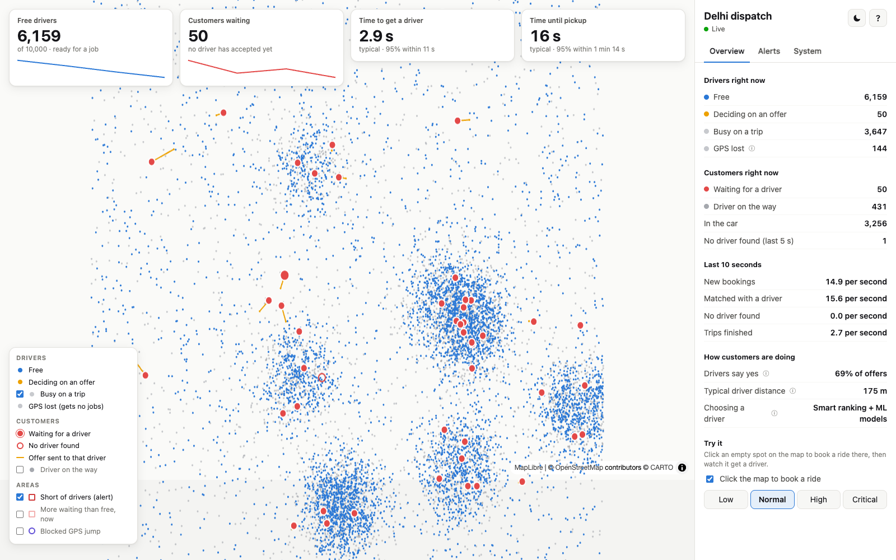

# Real-time Dispatch Engine

Given thousands of moving agents (drivers, ambulances, field staff) and a new
request, decide **who should take it right now**, in milliseconds, without
double-assigning anyone, and recover when agents reject, ignore offers or lose GPS.



*Live dashboard, 10,000 simulated drivers in Delhi NCR. Blue dots are free drivers, grey are busy, red circles are
customers waiting, and an amber line means an offer is out to that driver. The tiles on top are the four numbers a
person watching cares about, with 5-minute trends; the panel explains everything in plain words (and the "?" opens a
guide). Light and dark themes; colours checked to stay distinct for colour-blind viewers.*

## Architecture

```
 simulator (N agents) ──WS /gateway──►  API (Fastify + ws)
   pings every ~3s                        │
   accepts / rejects offers               ├─► Redis   live state: GEO index, last-seen, agent + request hashes,
   drives pickup → dropoff                │           offer deadlines. All state changes are atomic Lua scripts.
                                          │
 POST /requests ─────────────────────────►├─► dispatch: GEOSEARCH → filter (available, fresh, not tried)
                                          │             → rank (ETA, acceptance, zone depletion, GPS age, priority)
                                          │             → atomic claim → offer (timeout → next agent)
                                          │
                                          └─► Postgres + PostGIS   append-only request/event history (batched)

 dashboard (React + MapLibre + deck.gl) ◄──WS /live── live service (separate process)
   map, zone alerts, GPS anomalies,           every second: zone supply/demand → Redis (read by dispatch),
   latency and outcomes                       zone alerts, and a snapshot for dashboards
```

**Request lifecycle**

```
CREATED → SEARCHING → OFFERED → ASSIGNED → PICKED_UP → COMPLETED
              ▲          │
              └──────────┘  rejected / timed out → next candidate
SEARCHING → UNASSIGNED   (nobody eligible, or max attempts)
any open state → CANCELLED
```

Key design decisions:

- **No double assignment.** Claiming an agent is a Lua script that checks the agent is `AVAILABLE` and the request is still `SEARCHING`, then flips both in one atomic step.
- **Durable offer timeouts.** Deadlines live in a Redis sorted set, not in-process timers, so they survive restarts and work across multiple API instances.
- **Stale GPS is never dispatched.** A sweeper removes agents with no ping in 15s from the geo index, and dispatch re-checks freshness itself.
- **Cheap ingestion.** Each batch of pings, however large, becomes one `GEOADD` plus one `ZADD`.
- **The hot path never waits on Postgres.** Events are buffered and bulk-inserted every 500ms.
- **The dashboard doesn't slow dispatch down.** Snapshots are built in a separate process that only reads Redis.
  The first version built them inside the API and pushed dispatch p99 from ~20 ms to ~34 ms: Node runs one
  thing at a time, and parsing 10k agents plus `JSON.stringify` of ~500 KB took ~50 ms of that thread every
  second, on top of a 10k-result `GEOSEARCH` that kept Redis busy (next point).
- **Bulk reads that don't block Redis.** Positions are read with `ZRANGE` and the geohash scores decoded in JS
  (`apps/api/src/geohash.ts`, checked equal to `GEOPOS` for all 10k agents) instead of a 10k-result `GEOSEARCH`
  that would make Redis busy for ~14 ms. Status reads go through a Lua bulk `HMGET` in chunks of 2,000 keys.
- **A queue with backpressure in front of dispatch.** `POST /requests` creates the request and adds it to a Redis
  sorted set in one Lua script (or refuses with `429` + `Retry-After` when the queue is full, leaving nothing behind).
  128 workers per API instance pop with `BZPOPMIN`, so concurrency is bounded and several instances can share
  one queue. Score = priority rank × 10¹³ + created-at, so critical requests jump the line and the arrival time can
  be read back from the score. Popping is at-most-once, so a sweeper re-queues requests still `CREATED` after 30 s
  (a worker died holding them). `QUEUE_ENABLED=false` dispatches every request immediately instead.
- **Snapshot is serialised once and sent to every dashboard,** and not serialised at all while nobody is
  watching. A dashboard that falls behind skips frames instead of buffering without limit.

### Smart dispatch (Phase 3)

Candidates are ranked by **expected cost in seconds**, so every weight has a meaning you can argue about:

```
cost = ETA                              distance × 1.3 detour ÷ 9 m/s
     + (1 − p) / p × 20 s               expected declines before an accept (geometric), ~20 s lost each
     + depletion × weight × 90 s        taking the last free agents out of a zone about to need them
     + GPS age × 1 s/s                  an old position makes the ETA less certain
```

- **Acceptance `p`** is smoothed per agent: `(accepts + 0.75 × 4) / (offers + 4)`. A new agent starts at 75%, and
  one early rejection can't brand them unreliable. The counters are updated inside the existing accept/release Lua
  scripts, so they're exact.
- **Depletion** = how short the agent's zone would be over the next 5 minutes if we took them, from free agents
  now and the zone's recent request rate. 0 when the pickup is in the agent's own zone.
- **Priority** scales the depletion weight: low 1.5, normal 1, high 0.5, critical 0. A critical request gets the
  best agent even if that empties a zone.
- Zone supply/demand is computed once a second by the live service and stored in one Redis hash. Dispatch reads it
  with one `HMGET`, and treats stats older than 10 s as missing, so depletion simply switches off if the
  live service is down.
- Every `OFFERED` event stores the full score breakdown in Postgres: training data for Phase 5.
- `DISPATCH_STRATEGY=nearest` keeps the Phase 1 behaviour as a baseline.

**Impossible movement.** A ping implying more than 55 m/s (~200 km/h) over more than 300 m is dropped, so the agent
keeps its last good position (and goes stale, so gets no offers, if the bad fixes continue). If three consecutive
rejected pings agree with each other, the agent really did move (e.g. GPS came back after a tunnel), so the new position
is accepted. Known gap: an agent's *very first* fix has nothing to compare against, so if that one is bad the agent
sits at the wrong spot until three real fixes re-anchor it (~9 s; seen once in testing).

**Zone alerts.** A zone is short when ≥ 2 requests are expected there in the next 5 minutes and the free agents within
reach (the zone and its 8 neighbours, roughly dispatch's first 2 km search) cover less than half of them. Counting only
the zone itself flagged ~20 edge zones that sat right next to plenty of free agents. It must stay short for 10 s to raise an alert and stay fine for 30 s to clear it, so a noisy
second doesn't flap the alert. `critical` = no free agent at all. Served at `GET :4001/alerts` and on the dashboard.

## Run it

Requires Node 22+ and Docker. One command starts Redis + PostGIS, the API (:4000), the live service (:4001),
the simulator and the dashboard (Vite prints its URL, usually http://localhost:5173):

```bash
npm install
npm run dev
```

Bigger run (each trip takes several minutes, so ~15 req/s keeps 10,000 agents busy without running out):

```bash
AGENTS=10000 REQUESTS_PER_SEC=15 npm run dev
```

Each part can also run on its own: `npm run dev:api`, `dev:live`, `dev:sim`, `dev:dashboard`.

Tests and benchmarks:

```bash
npm test
scripts/compare-strategies.sh
loadtest/run.sh spike on
```

Retrain the Phase 5 models from whatever is in the event log (needs Python 3):

```bash
python3 -m venv ml/.venv
ml/.venv/bin/pip install numpy pandas scikit-learn
ml/export.sh
ml/.venv/bin/python ml/train.py
```

`npm test` runs the scoring, model and GPS-jump unit tests. `compare-strategies.sh` is nearest vs smart (~45 min, see
"Smart vs nearest" below). `loadtest/run.sh <steady|spike|breakpoint> <on|off>` runs a k6 scenario with the dispatch
queue on or off (needs [k6](https://k6.io)).

API:

| Method | Path | |
|---|---|---|
| `POST` | `/requests` | `{ lat, lng, priority? }` → creates and queues it (`201`), or `429` when the queue is full |
| `GET` | `/requests/:id` | current state |
| `POST` | `/requests/:id/cancel` | cancel and free the agent |
| `GET` | `/metrics` | fleet freshness, latency percentiles, outcomes (time to assign, wait to pickup), counters |
| `POST` | `/metrics/reset` | clear samples and counters (benchmarks use it to drop warm-up) |
| `WS` | `/gateway` | agent gateway (see `packages/shared/src/protocol.ts`) |
| `WS` | `:4001/live` | dashboard snapshot stream (see `packages/shared/src/live.ts`) |
| `GET` | `:4001/alerts` | current zone alerts |

The dashboard: hover anything for details, click a driver or customer to follow it, click an empty spot to book a
ride there (pick the priority in the panel), and click a zone alert to fly to it. The legend's checkboxes show the
optional layers (busy drivers, matched customers, short areas, blocked GPS jumps). `?theme=dark` forces dark mode.

Simulator settings (env): `AGENTS`, `REQUESTS_PER_SEC`, `PING_INTERVAL_MS`, `DARK_RATE`, `IGNORE_OFFER_RATE`,
`GPS_GLITCH_RATE`, `API_URL`. API and live service: `DISPATCH_STRATEGY` (`smart` | `ml` | `nearest`), `QUEUE_ENABLED`, `DISPATCH_WORKERS`
(default 128), `MAX_QUEUE` (default 2,000), and the `SCORE_*` weights in `apps/api/src/config.ts`.

## Measured so far

A single local run on a MacBook (Apple Silicon), with API, simulator, Redis and Postgres on the same machine:

| Agents | Load | Dispatch decision p50 / p95 / p99 | Median location freshness |
|---|---|---|---|
| 10,000 | 50 req/s for 40s | 4.7 / 12.2 / 26.4 ms | ~2.0 s |

"Decision" = search + filter + rank + atomic claim, measured inside the API.
This is not yet a proper burst benchmark. See the roadmap.

**Dashboard cost** (Phase 2). Fresh Redis and API per run, 10,000 agents, 50 req/s, 60 s each, one run per row:

| | Dispatch decision p50 / p95 / p99 | Request → first offer p99 |
|---|---|---|
| No dashboard | 5.1 / 10.4 / 20.5 ms | 26 ms |
| Dashboard connected, first version (inside the API, `GEOSEARCH` reads) | 4.5 / 11.7 / 34.3 ms | 55 ms |
| Dashboard connected, separate live service (current) | 4.6 / 13.0 / 22.4 ms | 30 ms |

Snapshot with 10,000 agents and ~1,200 drawn requests: ~500 KB of JSON once per second, built in
51 ms p50 / 62 ms p95 by the live service. Small run-to-run differences are within noise; all processes share one laptop.

**Smart vs nearest** (Phase 3), from `scripts/compare-strategies.sh`. 3,000 agents, 5 req/s, fresh Redis per run,
12 min warm-up discarded, then 10 min measured. Agents were scarce: ~97% busy by the end. One run per strategy.

| | nearest | smart |
|---|---|---|
| Requests that found no agent (unassigned) | 7.3% | 5.4% |
| Wait until pickup p50 / p95 | 194 / 433 s | 192 / 406 s |
| Pickup distance p50 / p95 | 3.1 / 8.4 km | 3.0 / 7.3 km |
| Offers accepted | 67.6% | 66.0% |
| Time to assign p50 / p95 | 2.9 / 11.0 s | 3.0 / 10.9 s |
| Dispatch decision p50 / p99 | 8.3 / 44.6 ms | 8.3 / 35.2 ms |

What this shows, honestly:

- **Zone protection helped.** Depletion was non-zero for 28% of smart offers. Fewer requests went unserved and the
  slow tail (p95 wait, p95 distance) got shorter, which is what keeping agents spread out should do.
- **Acceptance learning didn't help yet.** Each agent received ~3 offers over the run, too few to learn from, so
  `p` stayed close to the prior and the acceptance rate didn't move. It needs longer history, which is what the
  Phase 5 model trained on the Postgres event log is for.
- **One run each.** The direction is plausible, but I haven't run enough repeats to separate it from noise.
  Typical choice size was 6–8 candidates per offer (median), and 17–20% of offers had only one.

**Load tests** (Phase 4), k6 against a fresh system with 10,000 simulated agents and no other demand. k6, API,
live service, simulator, Redis and Postgres all on one MacBook, one run per row unless noted.

Steady, 50 req/s for 2 min, queue on: HTTP `POST /requests` p50 1.4 / p95 8.6 ms; request → first offer
p50 5 / p95 21 / p99 33 ms; queue wait p95 6 ms. No errors.

Spike: 20 req/s, jump to 400 req/s for 20 s, back to 20 (~10,700 requests):

| | Request → first offer p50 / p95 / p99 | HTTP p95 / max |
|---|---|---|
| Queue off | 3 ms / 252 ms / 573 ms | 79 ms / 1,218 ms |
| Queue on, 32 workers | 9 ms / 13.5 s / 13.8 s | 533 ms / 2,426 ms |
| Queue on, 128 workers (default) | 4 ms / 1.6 s / 1.8 s | 75 ms / 166 ms |

Breakpoint: ramp from 50 to 3,000 req/s over 3 min, stop when HTTP p95 > 500 ms or > 1% errors:

| | Result | HTTP p95 | Dispatch decision p99 |
|---|---|---|---|
| Queue off | collapsed at ~700 req/s offered (41 s in); a first run collapsed at ~260 req/s | 531 ms | 5.2 s |
| Queue on, 32 workers | survived the full ramp to 1,522 req/s offered, ~307/s accepted, 80% refused with 429 | 39 ms | 135 ms |
| Queue on, 128 workers | survived the full ramp to 1,522 req/s offered, ~325/s accepted, 79% refused with 429 | 111 ms | 452 ms |

What this shows, honestly:

- **Under real overload the queue keeps the system up.** Without it, every request gets dispatched at once: decisions
  took seconds, 6,500 claims collided over the same agents and HTTP latency blew through the limit. With it, zero
  errors at 1,522 req/s offered; excess load gets a fast, explicit `429` instead of a slow failure.
- **It costs something on short bursts.** A 20 s spike the unbounded path could absorb now waits in line.
- **Worker count is the lever (Little's law: throughput = workers ÷ time per dispatch).** When agents run out, a
  dispatch that finds nobody searches four widening radii (up to 400 agents each), which takes ~100 ms. 32 workers
  therefore cleared only ~300/s, under the 400/s spike, and a 13 s backlog built up. 128 workers cut it to 1.6 s.
- **Sustained dispatch capacity on this laptop is ~300–330 requests/s** once agents are exhausted (most requests
  end up searching and finding nobody). Lower `MAX_QUEUE` if you want shorter worst-case waits: a full 2,000-deep
  queue drained at ~300/s means ~7 s at the back of the line, so the cap should come from the longest acceptable wait.

### Learned models (Phase 5)

`ml/export.sh` pulls training data out of the Postgres event log (every offer with its score breakdown and outcome,
every pickup, every booking), `ml/train.py` fits three small models with scikit-learn and writes them as plain numbers
to `ml/models/*.json`, and `apps/api/src/ml.ts` evaluates them in TypeScript in microseconds. No Python at runtime.
`DISPATCH_STRATEGY=ml` swaps them into the Phase 3 ranking; everything else is unchanged.

Each model was judged on data it never saw, against the formula it replaces (full output in `ml/report.md`):

| Model | Replaces | Held-out result |
|---|---|---|
| **ETA**: seconds to reach the customer = a + b × distance (robust linear regression, 78k trips) | `distance × 1.3 ÷ 9 m/s` | Mean error **19.8 s → 4.2 s**. The formula assumed 6.9 m/s; real driving was ~11.3 m/s, so it overestimated every trip by ~20 s |
| **Demand**: zone's long-run share × city-wide bookings in the last 5 min | that zone's own last 5 min | Mean error per zone **1.53 → 1.19 bookings** (−22%), busiest 20 zones 6.70 → 5.21 |
| **Acceptance**: logistic regression on history rate, distance, attempt, priority (116k offers) | smoothed history `p` | Calibration slightly better (log loss 0.645 → 0.634), but ranking power **≈ none** (AUC 0.537 → 0.538) |

In every case a gradient-boosted model was also tried and did **not** beat the simple one, so the simple one ships.

Honest notes:

- **Acceptance isn't predictable from this data**, and the model says so instead of pretending. In the simulator each
  driver's accept rate is drawn at random per run and they see only a handful of offers, and nothing observable
  (distance, priority) changes their answer. A real fleet would have long histories, time of day and fare to learn from.
- **The ETA model is simple because the simulated world is**: drivers move in straight lines at a random speed. The
  value here is the pipeline (event log → features → time-split evaluation → shipped coefficients → online A/B), which
  is exactly what a road-network ETA would go through.
- A time split (train on the earlier 70%, test on the later 30%) is used so the models always predict the future.
  Demand uses 5-fold blocked cross-validation over time instead, because the latest 30% was too few windows.
- Load-test traffic (k6, 20–1,500 req/s and a different spatial spread) is excluded from the demand data.

**Online A/B (ml vs smart): not run yet.** The offline numbers above are measured; whether the learned models also
improve live dispatch outcomes is still open. Three attempts were ruined by the laptop sleeping mid-run (see
"Benchmarking on a laptop" below). To run it (~45 min, machine awake and plugged in):

```bash
STRATEGIES="nearest smart ml" scripts/compare-strategies.sh
```

The ml strategy has been checked live: it dispatches normally, offers use the learned ETA (~73 s/km vs the formula's
144 s/km) and the live service publishes the learned demand for all 624 zones.

### Benchmarking on a laptop

macOS pauses every process while the machine sleeps; when it wakes, timers fire at once, the simulator jumps its
drivers forward by the gap, and every trip in flight appears to have taken the length of the sleep. One such 18-minute
sleep turned a normal run's p95 pickup time into 16 minutes. The benchmark scripts therefore run under `caffeinate`
and refuse to report a measurement window whose wall-clock length doesn't match what was asked for.

## Roadmap

- [x] **Phase 1: core loop.** Ingestion, geo index, stale detection, state machine, atomic assignment, reassignment, event store, simulator
- [x] **Phase 2: live dashboard.** Map of agents and requests (MapLibre + deck.gl), zone supply/demand panel, live latency and throughput, separate read-only snapshot service
- [x] **Phase 3: smart dispatch.** Multi-factor ranking (ETA, acceptance probability, zone depletion, GPS staleness, priority), impossible-movement detection, zone capacity alerts, nearest-vs-smart benchmark
- [x] **Phase 4: scale and measure.** Request queue with backpressure and priority, k6 steady/spike/breakpoint tests, published p50/p95/p99
- [x] **Phase 5: ML.** ETA, acceptance and demand models trained on the event history and evaluated offline against the hand-written formulas; wired in as `DISPATCH_STRATEGY=ml` (online A/B still to run)
- [x] **Dashboard for people, not just engineers.** Plain-English panel, headline numbers with trends, legend, guide, light/dark, colour-blind-safe markers, drivers that glide between updates on the GPU. Demo script: [`docs/DEMO.md`](docs/DEMO.md)
